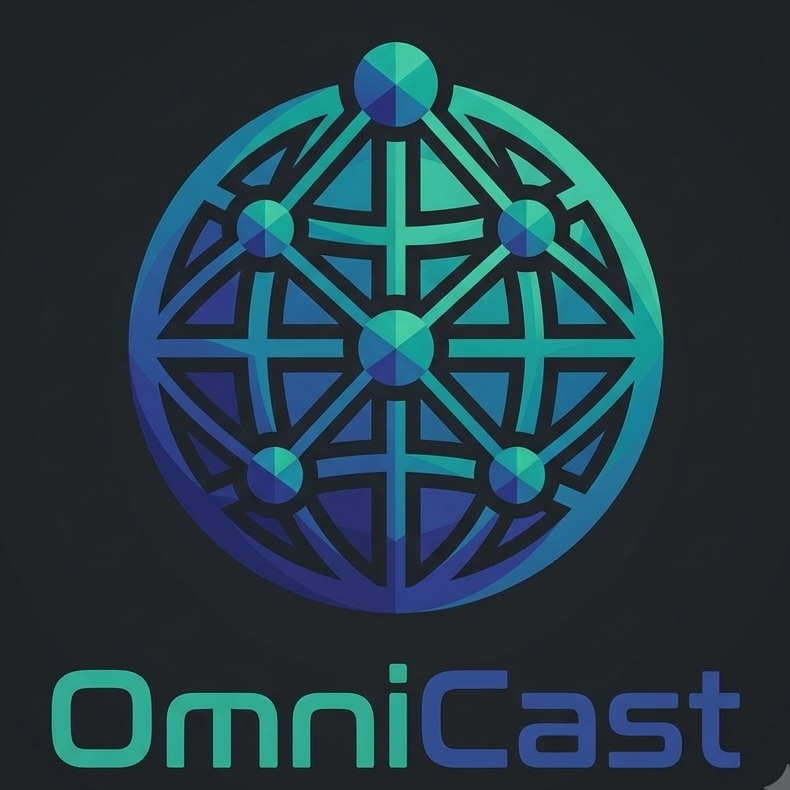

# OmniCast - Ultra-Low Latency WebRTC Remote Desktop

<div align="center">
  
  
  <h3>High-Performance, Peer-to-Peer Screen Streaming & Remote Desktop</h3>
  <p>An AnyDesk-inspired WebRTC remote desktop application with 60 FPS screen capture, sub-30ms latency, direct mouse & keyboard relay, and chunked P2P file transfers.</p>

  <p><b>Production Ready for Local Node.js & Instant 1-Click Vercel Deployment</b></p>
</div>

---

## 🌟 Universal Hybrid Architecture

OmniCast incorporates a dual-mode signaling architecture:

1. **Vercel Serverless / Global WebRTC Mesh (Cloud Mode)**:
   - Zero-server dependency for live deployment on Vercel, Netlify, or any static host.
   - Initial handshake (9-digit access code, security PIN, SDP offer/answer) is coordinated via WebRTC direct mesh.
   - Once paired, 100% of the 60 FPS video, audio, mouse, keyboard, and file transfer traffic streams **directly peer-to-peer (P2P)** between devices.
2. **Local / Dedicated Node.js (Host OS Control Mode)**:
   - When run locally (`npm start`), the built-in Node.js server with Socket.io enables the **Windows Native Desktop Controller (`user32.dll`)**, letting remote viewers physically control the host machine's mouse and keyboard.

---

## 🚀 Deploying to Vercel (1-Click Ready)

OmniCast is configured for Vercel with zero additional configuration needed (`vercel.json`, `api/`, and local bundled dependencies).

### Method A: Deploy via Vercel CLI
```bash
npm i -g vercel
vercel
```
Follow the prompts, and your application will be live with a URL like `https://omnicast.vercel.app`!

### Method B: Deploy via GitHub & Vercel Dashboard
1. Push this folder to a GitHub repository.
2. In the [Vercel Dashboard](https://vercel.com/new), click **Import Repository**.
3. Keep default settings (Framework Preset: **Other**, Root Directory: `./`).
4. Click **Deploy**.

---

## 💻 Running Locally (Node.js)

### Step 1: Install Dependencies
```bash
npm install
```

### Step 2: Start the Server
```bash
npm start
```
The server will start at:
```
http://localhost:3000
```

---

## 📖 How to Use OmniCast

1. **Host (Share Screen)**:
   - Open the web app on Computer A.
   - You will see **This Desk** displaying an auto-generated 9-digit Access Code (e.g. `482 910 384`).
   - Click **Copy** (or toggle "Require Security PIN" if you wish to set a PIN).
2. **Viewer (Control Partner)**:
   - Open the web app on Computer B (or another tab/window).
   - Enter the 9-digit Access Code in **Remote Desk** and click **Connect**.
3. **Approve on Host**:
   - An approval dialog will appear on Computer A with a 30-second countdown.
   - Click **Accept & Share Screen** and select your entire screen or window.
4. **Remote Session Active**:
   - The viewer sees the live 60 FPS display with sub-30ms latency.
   - Full mouse and keyboard inputs land with pixel accuracy thanks to letterbox compensation.
   - Use the floating top bar to send Special Keys (`Ctrl+Alt+Del`, `Win`, `Alt+Tab`), transfer files, sync clipboard, or toggle fullscreen.

---

## 📁 Project Structure

```
omni-cast/
├── vercel.json           # Vercel deployment & routing configuration
├── api/
│   ├── index.js          # Vercel serverless function entrypoint
│   └── status.js         # API status endpoint (/api/status)
├── server.js             # Local Node.js server & Socket.io signaling
├── native-controller.js  # Windows user32.dll native desktop input bridge
├── package.json          # Dependencies & build scripts
├── .gitignore            # Git ignore rules
├── public/
│   ├── index.html        # Main dashboard & active session views
│   ├── logo.png          # Official OmniCast brand logo
│   ├── css/
│   │   └── style.css     # Dark mode glassmorphism design
│   └── js/
│       ├── socket.io.min.js  # Bundled local Socket.io client
│       ├── peerjs.min.js     # Bundled local WebRTC mesh engine
│       └── app.js            # Universal WebRTC client engine & input relay
└── README.md             # Complete documentation
```

---

## 🔒 Security & Privacy

- **Direct Peer-to-Peer Encryption**: Audio, video, and data channels are encrypted using DTLS-SRTP.
- **PIN Authorization**: Optional 4–6 digit security PINs prevent unauthorized connections.
- **Explicit Consent**: Connections require explicit one-click approval on the host.
- **Immediate Revocation**: Host can lock remote control or terminate the stream at any time with one click.
