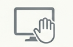
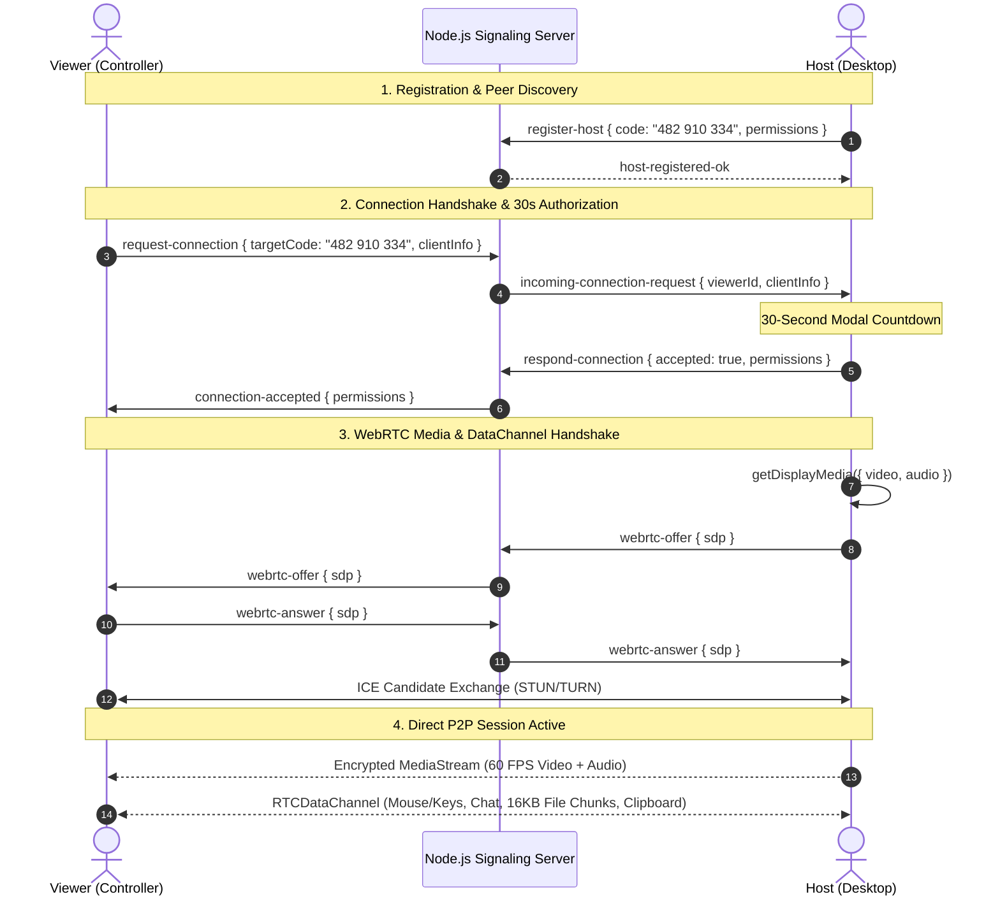

# OmniCast — Ultra-Low Latency WebRTC Remote Desktop (AnyDesk Grade)

<div align="center">
  
  
  <h3>Browser-Based Remote Desktop Powered by Native WebRTC & Node.js</h3>
  <p>Production-styled remote desktop prototype featuring AnyDesk dark theme, 9-digit session routing, interactive screen control, live WebRTC stats, 16KB chunked P2P file transfer, shared clipboard, and MediaRecorder screen recording.</p>

  <p>
    <a href="https://omni-cast.vercel.app"></a>
    
    
    
    
  </p>
</div>

---

## 📑 Table of Contents
1. [Tech Stack & Architecture](#-tech-stack--architecture)
2. [Project Folder Structure](#-project-folder-structure)
3. [Core Features](#-core-features)
4. [Signaling & WebRTC Protocol](#-signaling--webrtc-protocol)
5. [Frontend React Hook & Protocol Deliverables](#-frontend-react-hook--protocol-deliverables)
6. [Step-by-Step Testing & Execution](#-step-by-step-testing--execution)
7. [Native Windows Host Controller](#-native-windows-host-controller)

---

## 🛠 Tech Stack & Architecture

- **Frontend:** HTML5, Tailwind CSS, Lucide Icons, Vanilla ES6+ Engine (`js/app.js`), plus TypeScript React custom hook (`src/hooks/useWebRTC.ts`) and protocol handler (`src/protocol/dataChannelProtocol.ts`).
- **Backend / Signaling Server:** Node.js with Express and Socket.IO for peer discovery, room routing, SDP offer/answer exchange, and ICE candidate relay (`server.js`).
- **WebRTC Core:** Native browser `RTCPeerConnection`, `navigator.mediaDevices.getDisplayMedia()`, and `RTCDataChannel` (low-latency binary control, chat, 16KB chunked file transfer, and clipboard sync).
- **NAT Traversal:** Public Google STUN servers (`stun:stun.l.google.com:19302`) + Twilio global STUN + OpenRelay Metered TURN fallback for symmetric NATs.



---

## 📂 Project Folder Structure

```
omni-cast/
├── api/
│   ├── host-input.js          # Vercel serverless input bridge handler
│   ├── index.js               # Vercel API routing
│   └── status.js              # Server health & OS controller status
├── css/
│   └── style.css              # Production AnyDesk dark theme stylesheet
├── js/
│   ├── app.js                 # Frontend application engine & WebRTC multiplexer
│   └── peerjs.min.js          # Offline WebRTC library bundle
├── public/                    # Production static build synchronized for Vercel
│   ├── css/style.css
│   ├── js/app.js
│   ├── js/peerjs.min.js
│   ├── index.html
│   ├── logo.png
│   └── omnicast-logo.png
├── src/
│   ├── hooks/
│   │   └── useWebRTC.ts       # React/Next.js TypeScript custom WebRTC hook
│   └── protocol/
│       └── dataChannelProtocol.ts # Typed DataChannel packet encoder/decoder
├── index.html                 # Main AnyDesk dark theme entry point
├── native-controller.js       # Windows OS user32.dll DPI-aware input bridge
├── package.json               # Node.js project manifest & dependencies
├── README.md                  # Comprehensive project documentation
├── server.js                  # Node.js Express + Socket.IO signaling server
├── start.bat                  # One-click Windows launch script
└── vercel.json                # Vercel deployment configuration
```

---

## 🚀 Core Features

### 1. AnyDesk-Style Lobby / Dashboard (Home Screen)
- **Your Address Card:** Auto-generates a unique, readable 9-digit session ID (e.g., `482 910 334`) with 1-click copy button, refresh ID button, and glowing status indicator (*"Ready for incoming connections"*).
- **Remote Desk Input:** Input box with real-time numeric auto-formatting (`XXX XXX XXX`) and prominent AnyDesk red **"Connect"** button.
- **Security & Permissions Panel:** Pre-connection toggle switches for:
  - Allow Audio Sharing
  - Allow Remote Pointer & Annotations
  - Allow P2P File Transfer
  - Allow Clipboard Sync
  - Native Host OS Control (displays live status of the local Node.js Windows input bridge)
- **Recent Sessions List:** Persists connected 9-digit addresses in `localStorage` with relative timestamps (*"Just now"*, *"2 hours ago"*) and 1-click fast reconnect buttons.

### 2. Connection Handshake & 30-Second Authorization Flow
- When Peer A requests connection to Peer B:
  - Peer A sees a waiting spinner: *"Waiting for remote host approval..."*.
  - Peer B receives an **Incoming Connection Request Modal** displaying Peer A's 9-digit ID, browser/OS system info, and requested permissions.
  - Features an animated **30-second countdown bar and timer** (`30s` to `0s`). If unhandled, it auto-declines to prevent unattended access.
  - Upon clicking **"Accept & Share"**, Peer B is prompted to select their screen via `getDisplayMedia()`, and the WebRTC `MediaStream` and `RTCDataChannel` establish automatically.

### 3. Active Remote Session View (Viewer / Controller Screen)
- **Full-Viewport Video Canvas:** Aspect-ratio preservation (`object-contain`), toggle between fit-to-screen and 1:1 original pixel scale, and fullscreen toggle.
- **Simulated Remote Control & Laser via DataChannel:**
  - Real-time mouse movement, clicks, double clicks, right clicks, and scroll wheel.
  - Dynamic laser pointer mode with glowing trail and animated click ripples.
  - Host screen overlay displaying mirrored cursor movement and click ripple feedback.
  - Special keys popover: `Ctrl + Alt + Del` (Task Manager), `Windows Key` (Start Menu), `Alt + Tab` (Task Switcher), `Escape`, plus quick text sender.
- **Floating Top Action Toolbar (Auto-Hiding):**
  - Slides down on mouse hover near top (60px), auto-hides after 3 seconds of inactivity.
  - **Live WebRTC Stats Pill:** Real-time polling via `RTCPeerConnection.getStats()` displaying **RTT (ms)**, **FPS**, **Bitrate (kbps/Mbps)**, and **Resolution (1080p/720p)**.
  - **Screen Quality Selector:** Dynamically adjusts bitrate and resolution constraints (Auto / 1080p@60 / 720p@30 / 480p).
  - **Screen Recorder:** One-click recording of incoming screen stream using `MediaRecorder` (`video/webm;codecs=vp9,opus`), featuring live duration counter (`REC 00:15`) and automatic file download upon stopping.
  - **Audio Mute/Unmute:** Toggle remote desktop audio stream.
  - **Disconnect Button:** Red AnyDesk button for graceful session teardown.

### 4. Collapsible Side Drawer (Session Tools)
- **Tab 1: Live P2P Text Chat:** Instant bidirectional messaging over `RTCDataChannel` with timestamps and unread notification badge on the toolbar.
- **Tab 2: P2P File Transfer:** Drag-and-drop zone and file picker. Slices files into **16KB binary chunks** over `RTCDataChannel` with live progress bar (percentage, transfer speed in KB/s) and auto-reassembly and download on the receiver side.
- **Tab 3: Shared Clipboard:** Push local clipboard text directly to remote partner, or pull partner's clipboard text into your own clipboard with 1-click.

---

## 📡 Signaling & WebRTC Protocol

Data transferred over the `omnicast-control` RTCDataChannel uses a typed, low-overhead JSON protocol:

```typescript
// 1. Mouse & Laser Events
{ "type": "mouse-move", "x": 0.4521, "y": 0.3812 }
{ "type": "mouse-down", "button": 0, "x": 0.4521, "y": 0.3812 }
{ "type": "mouse-up", "button": 0, "x": 0.4521, "y": 0.3812 }
{ "type": "laser", "x": 0.4521, "y": 0.3812 }

// 2. Keystroke Events
{ "type": "key-down", "key": "Enter", "code": "Enter", "ctrlKey": false }
{ "type": "special-key", "key": "CAD" } // Ctrl+Alt+Del

// 3. 16KB Chunked File Transfer
{ "type": "file-start", "id": "tx_abc", "name": "document.pdf", "size": 1048576, "totalChunks": 64 }
{ "type": "file-chunk", "id": "tx_abc", "chunkIndex": 0, "totalChunks": 64, "data": "data:application/pdf;base64,..." }
{ "type": "file-end", "id": "tx_abc" }

// 4. Shared Clipboard
{ "type": "clipboard-push", "text": "https://example.com" }
{ "type": "clipboard-pull-req" }
{ "type": "clipboard-pull-resp", "text": "https://example.com" }
```

---

## 💻 Frontend React Hook & Protocol Deliverables

For React / Next.js developers, the project provides typed modules in `src/`:

- **`src/protocol/dataChannelProtocol.ts`:** Complete TypeScript packet definitions and `encodePacket` / `decodePacket` handlers.
- **`src/hooks/useWebRTC.ts`:** Production React hook exposing:
  ```tsx
  import { useWebRTC } from './hooks/useWebRTC';

  function RemoteViewer() {
    const {
      connectionState,
      myId,
      remoteStream,
      stats,
      chatMessages,
      connectToRemoteDesk,
      startScreenShare,
      disconnect,
      sendChatMessage,
      sendFile
    } = useWebRTC();

    return (
      <div>
        <p>Your ID: {myId}</p>
        <button onClick={() => connectToRemoteDesk('482910334')}>Connect</button>
        <p>RTT: {stats.rtt}ms | FPS: {stats.fps} | Bitrate: {stats.bitrate}</p>
      </div>
    );
  }
  ```

---

## 🧪 Step-by-Step Testing & Execution

### Option A: Local Testing with Node.js & Windows Host Control

1. **Install Dependencies:**
   ```bash
   npm install
   ```

2. **Start the Signaling Server & Host OS Input Bridge:**
   ```bash
   npm start
   # or on Windows, double-click:
   start.bat
   ```
   The server launches at `http://localhost:3000`.

3. **Multi-Tab or Multi-Device Testing:**
   - **Tab 1 (Host):** Navigate to `http://localhost:3000`. Copy your 9-digit address (e.g. `482 910 334`).
   - **Tab 2 (Viewer):** Open a second browser window (or Incognito window). Enter the 9-digit address in **Remote Desk** and click **Connect**.
   - **Tab 1:** An Incoming Connection Request modal appears with a 30-second countdown timer. Click **"Accept & Share"** and select a screen to share.
   - **Tab 2:** The remote screen renders smoothly. You can move the mouse, toggle Laser mode, send chat messages, transfer files via drag-and-drop, and monitor live stats in the top toolbar!

---

### Option B: Cloud Deployment on Vercel

OmniCast is configured for instant Vercel static and serverless hosting:
- Live at: `https://omni-cast.vercel.app`
- Both root files and `public/` files are kept in sync, ensuring that Vercel static serving functions identically to local execution.

---

## 🛡 Native Windows Host Controller

When running locally with `node server.js`:
- `native-controller.js` attaches directly to Windows `user32.dll` via PowerShell P/Invoke.
- Calls `SetProcessDPIAware()` to guarantee pixel-perfect coordinates across high-DPI and 4K displays.
- Translates normalized DataChannel pointer coordinates (`0.0` - `1.0`) directly into physical OS mouse cursor coordinates, clicks, scrolls, and key presses.

---

## 📄 License
MIT License. Built with native WebRTC standards for ultra-low latency remote collaboration.
